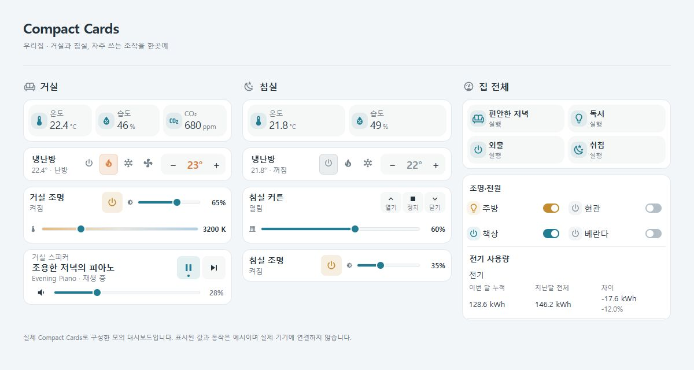
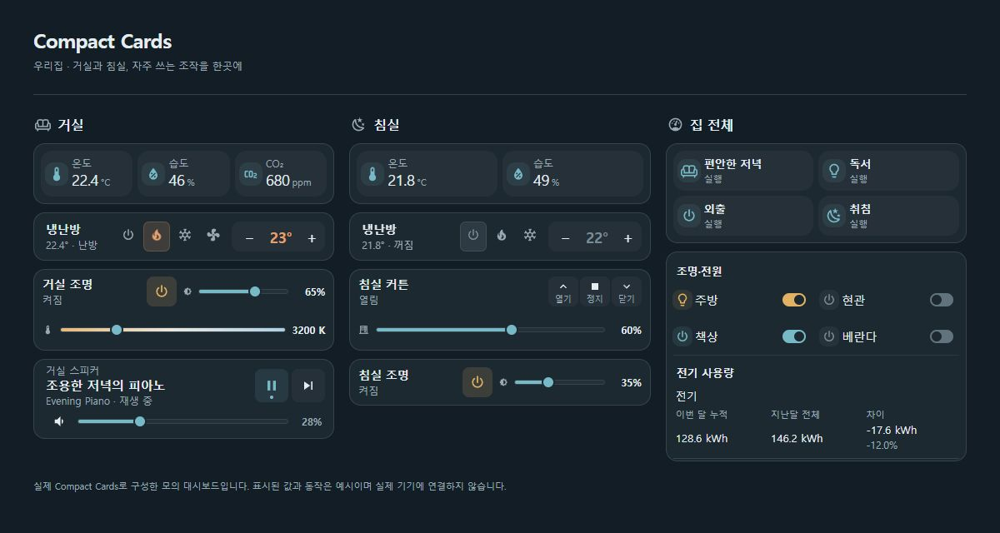

# Compact Cards for Home Assistant

방 하나의 제어를 작은 공간에 정돈하는 Home Assistant 카드입니다. 상태를 한눈에 읽고, 카드에서 바로 조작합니다.

[English](README.md) | **한국어**

[](https://github.com/eigger/hass-compact-cards/releases)
[](#설치)
[](https://github.com/eigger/hass-compact-cards/actions/workflows/check.yml)
[](LICENSE)
[](https://github.com/eigger/hass-compact-cards/releases)

## 주요 기능



*실제 카드 JavaScript와 모의 상태로 렌더링한 로컬 미리보기입니다. 실제 기기 연결 검증 화면은 아닙니다.*

<details>
<summary>다크 테마 보기</summary>



</details>

전원·밝기·온도·커튼 위치·재생처럼 자주 쓰는 조작을 가까이 모읍니다. 카드 너비에 따라 배치를 조정하고 Home Assistant 테마 색상을 사용합니다. UI와 YAML 편집을 지원하며, 별도 빌드나 외부 런타임 라이브러리 없이 JavaScript 파일 하나에 9종 카드가 포함됩니다.

### 카드와 사용 가이드

각 문서에서 옵션과 YAML 예제를 확인할 수 있습니다. 기존 제어 카드 가이드는 화면 예시도 제공합니다. 독립 카드를 조합하거나 홈 패널 안에 제어 행을 넣어 구성하세요.

| 카드 / 가이드 | 용도 | YAML 유형 |
| --- | --- | --- |
| [홈 패널](docs/compact-home-panel.md) | 방의 제어·센서·사용량 비교를 한곳에 | `custom:compact-home-panel` |
| [냉난방](docs/compact-climate-row.md) | 아이콘 중심 모드 선택과 설정 온도 | `custom:compact-climate-row` |
| [조명](docs/compact-light-row.md) | 전원·밝기·지원 색온도 | `custom:compact-light-row` |
| [커튼](docs/compact-cover-row.md) | 열기·정지·닫기·지원 위치 제어 | `custom:compact-cover-row` |
| [장면](docs/compact-scene-panel.md) | 장면·스크립트 바로 실행 | `custom:compact-scene-panel` |
| [환경](docs/compact-environment-panel.md) | 센서 값과 설정한 임계값 | `custom:compact-environment-panel` |
| [미디어](docs/compact-media-row.md) | 재생·음소거·지원 음량 제어 | `custom:compact-media-row` |
| [이미지](docs/compact-image-card.md) | 사진·평면도·이미지 엔티티 표시 | `custom:compact-image-card` |
| [카메라](docs/compact-camera-card.md) | 작은 카메라 썸네일·터치하여 상세 보기 | `custom:compact-camera-card` |

[조작감과 상태 표시](docs/polish.md) · [UX 개선 내용](docs/ux-refinements.md) · [조명·커튼 설정](docs/light-cover.md) · [장면·환경 설정](docs/scene-environment.md)

## 설치

[](https://my.home-assistant.io/redirect/marketplace_repository/?owner=eigger&repository=hass-compact-cards&category=plugin)

Home Assistant 2026.11 이상에서 마켓플레이스를 이용합니다.

1. 위 배지를 누르거나 **설정 → 마켓플레이스 → 링크에서 추가**에 <https://github.com/eigger/hass-compact-cards> 주소를 입력합니다. 안내가 표시되면 GitHub 계정을 연결합니다.
2. **설치**를 누르고 브라우저를 새로고침합니다. 리소스를 YAML로 관리한다면 설치 화면에 표시된 항목을 추가합니다.
3. 대시보드에 카드를 추가합니다. [빠른 시작](#빠른-시작)

### 수동 설치

1. [최신 릴리스](https://github.com/eigger/hass-compact-cards/releases/latest)의 `compact-cards.js`를 `/config/www/`에 복사합니다. 폴더가 없다면 생성합니다.
2. 대시보드 리소스에 아래 URL을 **JavaScript 모듈**로 추가하고 브라우저를 새로고침합니다. YAML로 관리한다면 기존 리소스 목록에 아래 항목을 추가합니다.

```yaml
url: /local/compact-cards.js
type: module
```

## 빠른 시작

```yaml
type: custom:compact-climate-row
entity: climate.living_room
name: 거실 냉난방
```

```yaml
type: custom:compact-home-panel
items:
  - type: heading
    name: 거실
  - entity: light.living_room
    name: 조명
  - entity: sensor.living_room_temperature
    name: 온도
  - type: climate
    entity: climate.living_room
    name: 냉난방
```

엔티티 ID는 실제 환경에 맞게 변경하세요. 추가 예제는 `examples/dashboard.yaml`에 있습니다.

카드 추가 화면에서도 **Compact climate row**, **Compact home panel**을 선택할 수 있습니다. 9종 모두 [시각적 설정 편집기](docs/visual-editor.md)를 제공하며 YAML 편집도 지원합니다.

## 설정

### `custom:compact-climate-row`

| 옵션 | 설명 |
| --- | --- |
| `entity` | 필수. `climate.*` 엔티티 |
| `name` | 표시 이름. 생략 시 엔티티의 이름 사용 |

엔티티가 제공하는 운전 모드만 표시합니다. 좁은 카드에서는 모드 버튼을 이름과 온도 아래에 배치하며, 모드가 4개 이상이면 540px 이하(터치 환경은 640px 이하)에서 두 줄로 표시합니다. 터치 환경의 버튼 조작 영역은 44px입니다. 단일 목표 온도를 지원하는 기기에서 −/+로 온도를 변경하며, 기기의 온도 간격과 최솟값·최댓값을 적용합니다. 상한/하한 온도 범위만 지원하는 기기는 온도 버튼이 비활성화됩니다. 이름을 누르면 Home Assistant 상세 정보가 열립니다.

### `custom:compact-home-panel`

`items`에 아래 항목을 조합합니다. 일반 엔티티 항목은 두 열로 표시하고 380px 이하에서는 한 열로 전환합니다. `columns`는 `auto`(기본), `1`, `2`로 설정할 수 있습니다. 제목·메모·냉난방·조명 행·커튼·비교·탐색과 select 항목은 전체 너비를 사용합니다.

| 항목 | 필드와 동작 |
| --- | --- |
| 일반 엔티티 | `entity`, 선택적 `name`, `icon`. `light`/`switch`는 토글, `lock`은 상태 버튼(누르면 잠금/해제), `select`는 옵션 선택, 나머지는 상태 표시 |
| 이름으로 센서 찾기 | `find_name`, 선택적 `domain`(기본 `sensor`). 같은 도메인에 동일 이름이 여러 개면 확인 불가로 표시. 상태 표시용 |
| `type: heading` | `name`, 선택적 `badges: [{entity: sensor.example, name: 온도}]` |
| `type: note` | `name`에 메모 내용 |
| `type: climate` | `entity: climate.*`, 선택적 `name` |
| `type: navigate` | `name`, `navigation_path: /dashboard-name/view`, 선택적 `icon` |
| `type: comparison` | `rows`에 `name`, `entity`(이번 달), `previous`(지난달) 지정 |

사용량 비교는 두 센서의 현재 값과 단위를 비교합니다. 월별 통계를 직접 조회하거나 센서를 생성하지 않으므로, 이번 달 누적 센서와 지난달 전체 센서를 별도로 준비하세요.

버튼이나 스크립트 실행은 일반 엔티티 항목에 `tap_action`을 추가합니다. `light`, `switch`, `select`는 전용 제어를 사용하므로 실행 버튼 설정이 적용되지 않습니다. `perform-action` 실행 버튼을 지정한 `lock` 항목은 상태 버튼 대신 그 버튼을 표시합니다.

```yaml
type: custom:compact-home-panel
items:
  - entity: script.good_night
    name: 취침 모드
    tap_action:
      action: perform-action
      perform_action: script.turn_on
      target:
        entity_id: script.good_night
```

`data`로 서비스 데이터를 전달할 수 있습니다. `target`을 생략하면 항목의 `entity`를 대상으로 사용합니다. 사용할 수 없는 엔티티는 제어가 비활성화됩니다.

## 중요 제한사항

내장 제어 레이블과 알림은 현재 한국어로 표시됩니다. 최소 Home Assistant 버전과 실제 기기 제어는 확인이 필요합니다.

## 문서

[대시보드 구성 YAML](examples/showcase.yaml) · [방별 대시보드 가이드](docs/showcase.md) · [UI 설정 가이드](docs/visual-editor.md)

### 문제 해결

- `Custom element doesn't exist`: 리소스 URL과 JavaScript 모듈 유형을 확인하고 브라우저를 강력 새로고침하세요. 마켓플레이스와 수동 설치 중 한 경로의 리소스만 등록하세요.
- `확인 불가`: 엔티티 ID와 상태를 확인하세요. `unknown`/`unavailable` 상태에서는 제어하지 않지만, 아직 실행하지 않은 버튼·스크립트·장면은 `unknown`이어도 실행할 수 있습니다.
- 변경 실패 알림: 해당 엔티티에서 지원하는 서비스인지 Home Assistant 개발자 도구에서 확인하세요.

### 개발

- `compact-cards.js`: 외부 런타임 의존성이 없는 카드 번들
- `hacs.json`: 마켓플레이스 설치 메타데이터
- `examples/dashboard.yaml`: 대시보드 카드 구성 예제
- `npm run check`: JavaScript 문법 검사 (Node.js 필요)
- `npm test`: DOM 기반 카드 동작 테스트

개발에는 Node.js 22 이상과 `npm ci`가 필요합니다. DOM 테스트는 Happy DOM을 사용합니다. 실제 Home Assistant 화면 및 기기 연결 검증은 별도로 필요합니다.

```sh
npm ci
npm run check
npm test
```

[공유 검사 workflow](.github/workflows/check.yml)는 일반 푸시와 PR에서 Node.js 22로 문법 검사와 DOM 테스트를 실행하고 번들 파일을 확인합니다. 실제 Home Assistant에서의 표시와 기기 동작은 별도로 확인해야 합니다.

Dependabot은 npm과 GitHub Actions 의존성을 매주 검사합니다. 중앙 workflow의 새 버전도 갱신 PR로 제안합니다. patch·minor는 필수 CI를 통과하면 자동 스쿼시 병합할 수 있으며 major는 수동 검토합니다. 중앙 workflow 참조를 갱신할 때 기준 문서의 버전과 SHA도 맞춥니다. [기준 문서(영어)](STANDARDS.md) · [검증 기록(영어)](ADOPTION_CHECKLIST.md)

자동 머지 workflow는 PR 메타데이터를 확인하고 병합된 Dependabot 브랜치를 정리합니다. PR 코드를 체크아웃하지 않습니다.

### 배포

배포 형식은 [마켓플레이스 대시보드 카드 안내](https://contributors.home-assistant.io/marketplace/guides/dashboard/)를 따릅니다. `hacs.json`이 루트의 `compact-cards.js`를 설치 파일로 지정하므로 별도 빌드가 필요 없습니다.

1. 프로젝트를 GitHub 저장소에 커밋하고 푸시합니다.
2. `package.json`의 버전을 변경하고 `npm ci`, `npm run check`, `npm test`로 확인합니다.
3. 변경 사항을 커밋한 뒤 버전과 일치하는 태그(최초 버전: `v0.1.0`)를 푸시합니다.
4. [공유 릴리스 workflow](.github/workflows/release.yml)가 검사 후 GitHub Release를 생성하고 `compact-cards.js`를 첨부합니다. 저장소의 Actions 실행이 허용되어 있어야 합니다.

일반 푸시와 Pull Request에서도 문법 검사와 테스트가 실행됩니다. 릴리스 없이 기본 브랜치에서 설치하는 방식도 지원합니다.

태그를 푸시하기 전에 [변경 기록](CHANGELOG.md)에 사용자 영향과 필요한 조치를 남기고, 마켓플레이스 설치·브라우저 표시·실제 기기 제어를 확인하세요. 태그 `vX.Y.Z`는 `package.json`의 안정 버전 `X.Y.Z`와 일치해야 합니다. 사전 릴리스는 수동으로 게시합니다. 테스트는 읽기 권한으로 실행하고, 같은 커밋을 게시하는 별도 job에만 쓰기 권한을 부여합니다.

## 지원

- [Issues](https://github.com/eigger/hass-compact-cards/issues): 버그 신고와 기능 요청.
- [Discussions](https://github.com/eigger/hass-compact-cards/discussions): 질문과 사용 경험 공유.
- [GitHub Sponsors](https://github.com/sponsors/eigger): 개발 후원.

## 관련 프로젝트

- [Overview Cards](https://github.com/eigger/hass-overview-cards)는 홈 패널 행을 대시보드 요약에 넣을 수 있습니다.

## 라이선스

이 프로젝트는 [MIT 라이선스](LICENSE)를 따릅니다.
