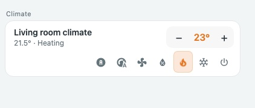
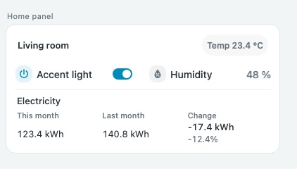
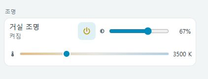
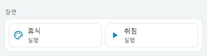
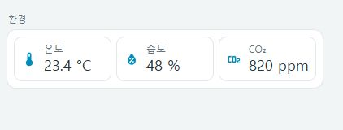
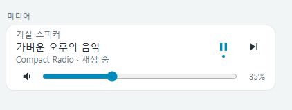

# Compact Cards

Home Assistant를 위한 작고 정돈된 대시보드 커스텀 카드 모음입니다.

[English](README.md) | **한국어**

통합(integration)이 아닌 프런트엔드 카드 프로젝트입니다. 별도 빌드나 외부 라이브러리 없이 JavaScript 파일 하나로 사용합니다.

## 포함된 카드

| 카드 유형 | 설명 |
| --- | --- |
| `custom:compact-climate-row` | 운전 모드와 설정 온도를 한 줄로 제어하는 기후 카드 |
| `custom:compact-home-panel` | 제어, 센서, 제목, 메모, 탐색, 사용량 비교를 묶는 패널 |
| `custom:compact-light-row` | 전원·밝기·색온도를 직접 제어하는 조명 행 |
| `custom:compact-cover-row` | 열기·정지·닫기·위치를 직접 제어하는 커튼 행 |
| `custom:compact-scene-panel` | 한 번에 실행하는 장면·스크립트 바로가기 |
| `custom:compact-environment-panel` | 온도·습도·공기질과 사용자 지정 임계값 |
| `custom:compact-media-row` | 곡 정보·재생·다음 곡·음량 직접 제어 |

[조명·커튼 설정 가이드](docs/light-cover.md). 홈 패널의 `items`에서도 `type: light`, `type: cover`로 사용할 수 있습니다.


[장면·환경 패널 가이드](docs/scene-environment.md)에서 설정과 예제를 확인하세요.

## 카드 미리보기와 상세 가이드

모의 상태로 렌더링한 대표 화면입니다. 각 카드별 문서에 옵션과 상세 YAML 예제를 제공합니다.

| 카드 / 전용 문서 | 대표 이미지 |
| --- | --- |
| [냉난방](docs/compact-climate-row.md) |  |
| [홈 패널](docs/compact-home-panel.md) |  |
| [조명](docs/compact-light-row.md) |  |
| [커튼](docs/compact-cover-row.md) |  |
| [장면](docs/compact-scene-panel.md) |  |
| [환경](docs/compact-environment-panel.md) |  |
| [미디어](docs/compact-media-row.md) |  |

[UI 설정 가이드](docs/visual-editor.md): 엔티티 선택, 항목 추가·정렬, 임계값과 실행 확인을 화면에서 설정합니다.

## HACS 설치

[이 저장소](https://github.com/eigger/hass-compact-cards)를 HACS의 **사용자 지정 저장소(Custom repositories)** 로 설치할 수 있습니다. 기본 HACS 목록에 등록된 프로젝트는 아닙니다.

1. HACS → 오른쪽 위 메뉴 → 사용자 지정 저장소를 엽니다.
2. 이 프로젝트의 GitHub 저장소 URL을 입력하고 유형을 **Dashboard**로 선택합니다. 구버전 HACS에서는 **Lovelace** 또는 **Plugin**으로 표시될 수 있습니다.
3. **Compact Cards**를 찾아 다운로드한 뒤 브라우저를 새로고침합니다.
4. 설정 → 대시보드 → 리소스에서 아래 리소스가 등록되었는지 확인합니다. 없으면 JavaScript 모듈로 추가합니다. 리소스 메뉴는 고급 모드에서 표시될 수 있습니다.

```yaml
url: /hacsfiles/hass-compact-cards/compact-cards.js
type: module
```

위 경로는 GitHub 저장소 이름이 `hass-compact-cards`인 경우입니다. 다른 이름으로 게시했다면 해당 경로도 변경하세요. `compact-cards.js` 하나에 모든 카드가 포함되어 있습니다.

## 수동 설치

1. `compact-cards.js`를 Home Assistant의 `/config/www/compact-cards.js`로 복사합니다. `www` 폴더가 없으면 생성합니다.
2. 대시보드 리소스에 `/local/compact-cards.js`를 JavaScript 모듈로 등록합니다.
3. 브라우저를 새로고침하고 카드 구성에 아래 예제를 사용합니다.

리소스를 YAML로 관리하는 환경에서는 다음 항목을 기존 리소스 목록에 추가합니다.

```yaml
url: /local/compact-cards.js
type: module
```

## 사용 예제

```yaml
type: custom:compact-climate-row
entity: climate.living_room
name: 거실 냉난방
```

```yaml
type: custom:compact-home-panel
items:
  - type: heading
    name: 거실
  - entity: light.living_room
    name: 조명
  - entity: sensor.living_room_temperature
    name: 온도
  - type: climate
    entity: climate.living_room
    name: 냉난방
```

엔티티 ID는 실제 환경에 맞게 변경하세요. 추가 예제는 `examples/dashboard.yaml`에 있습니다.

카드 추가 화면에서도 **Compact climate row**, **Compact home panel**을 선택할 수 있습니다. 7종 모두 [시각적 설정 편집기](docs/visual-editor.md)를 제공하며 YAML 편집도 지원합니다.

내장 제어 레이블과 알림은 현재 한국어로 표시됩니다.

## 설정

### `custom:compact-climate-row`

| 옵션 | 설명 |
| --- | --- |
| `entity` | 필수. `climate.*` 엔티티 |
| `name` | 표시 이름. 생략 시 엔티티의 이름 사용 |

엔티티가 제공하는 운전 모드만 표시합니다. 좁은 카드에서는 모드 버튼을 이름과 온도 아래에 배치하며, 모드가 4개 이상이면 540px 이하(터치 환경은 640px 이하)에서 두 줄로 표시합니다. 터치 환경의 버튼 조작 영역은 44px입니다. 단일 목표 온도를 지원하는 기기에서 −/+로 온도를 변경하며, 기기의 온도 간격과 최솟값·최댓값을 적용합니다. 상한/하한 온도 범위만 지원하는 기기는 온도 버튼이 비활성화됩니다. 이름을 누르면 Home Assistant 상세 정보가 열립니다.

### `custom:compact-home-panel`

`items`에 아래 항목을 조합합니다. 일반 엔티티 항목은 두 열로 표시하고 380px 이하에서는 한 열로 전환합니다. `columns`는 `auto`(기본), `1`, `2`로 설정할 수 있습니다. 제목·메모·냉난방·조명 행·커튼·비교·탐색과 select 항목은 전체 너비를 사용합니다.

| 항목 | 필드와 동작 |
| --- | --- |
| 일반 엔티티 | `entity`, 선택적 `name`, `icon`. `light`/`switch`는 토글, `select`는 옵션 선택, 나머지는 상태 표시 |
| 이름으로 센서 찾기 | `find_name`, 선택적 `domain`(기본 `sensor`). 같은 도메인에 동일 이름이 여러 개면 확인 불가로 표시. 상태 표시용 |
| `type: heading` | `name`, 선택적 `badges: [{entity: sensor.example, name: 온도}]` |
| `type: note` | `name`에 메모 내용 |
| `type: climate` | `entity: climate.*`, 선택적 `name` |
| `type: navigate` | `name`, `navigation_path: /dashboard-name/view`, 선택적 `icon` |
| `type: comparison` | `rows`에 `name`, `entity`(이번 달), `previous`(지난달) 지정 |

사용량 비교는 두 센서의 현재 값과 단위를 비교합니다. 월별 통계를 직접 조회하거나 센서를 생성하지 않으므로, 이번 달 누적 센서와 지난달 전체 센서를 별도로 준비하세요.

버튼이나 스크립트 실행은 일반 엔티티 항목에 `tap_action`을 추가합니다. `light`, `switch`, `select`는 전용 제어를 사용하므로 실행 버튼 설정이 적용되지 않습니다.

```yaml
type: custom:compact-home-panel
items:
  - entity: script.good_night
    name: 취침 모드
    tap_action:
      action: perform-action
      perform_action: script.turn_on
      target:
        entity_id: script.good_night
      confirmation:
        text: 취침 모드를 실행할까요?
```

`data`로 서비스 데이터를 전달할 수 있습니다. `target`을 생략하면 항목의 `entity`를 대상으로 사용합니다. 사용할 수 없는 엔티티는 제어가 비활성화됩니다.

## 배포

HACS 형식은 [공식 배포 문서](https://hacs.dev/docs/publish/start/)를 기준으로 구성했습니다. `hacs.json`이 루트의 `compact-cards.js`를 설치 파일로 지정하므로 별도 빌드가 필요 없습니다.

1. 프로젝트를 GitHub 저장소에 커밋하고 푸시합니다.
2. `package.json`의 버전을 변경하고 `npm ci`, `npm run check`, `npm test`로 확인합니다.
3. 변경 사항을 커밋한 뒤 버전과 일치하는 태그(최초 버전: `v0.1.0`)를 푸시합니다.
4. GitHub Actions가 검사 후 Release를 생성하고 `compact-cards.js`를 첨부합니다. 저장소의 Actions 실행이 허용되어 있어야 합니다.

일반 푸시와 Pull Request에서도 문법 검사와 테스트가 실행됩니다. 릴리스 없이 기본 브랜치에서 설치하는 방식도 지원합니다.

태그를 푸시하기 전에 [변경 기록](CHANGELOG.md)에 사용자 영향과 필요한 조치를 남기고, HACS 설치·브라우저 표시·실제 기기 제어를 확인하세요. 태그와 `package.json`은 `vX.Y.Z` 형식의 동일한 안정 버전이어야 합니다. 테스트는 읽기 권한으로 실행하고, 같은 커밋을 게시하는 별도 job에만 쓰기 권한을 부여합니다.

## 문제 해결

- `Custom element doesn't exist`: 리소스 URL과 JavaScript 모듈 유형을 확인하고 브라우저를 강력 새로고침하세요. HACS 설치와 수동 설치 리소스를 중복 등록하지 마세요.
- `확인 불가`: 엔티티 ID와 상태를 확인하세요. `unknown`/`unavailable` 상태에서는 제어하지 않습니다.
- 변경 실패 알림: 해당 엔티티에서 지원하는 서비스인지 Home Assistant 개발자 도구에서 확인하세요.

## 로컬 작업

- `compact-cards.js`: 외부 런타임 의존성이 없는 카드 번들
- `hacs.json`: HACS 설치 메타데이터
- `examples/dashboard.yaml`: 대시보드 카드 구성 예제
- `npm run check`: JavaScript 문법 검사 (Node.js 필요)
- `npm test`: DOM 기반 카드 동작 테스트

개발에는 Node.js 22 이상과 `npm ci`가 필요합니다. DOM 테스트는 Happy DOM을 사용합니다. 실제 Home Assistant 화면 및 기기 연결 검증은 별도로 필요합니다.

```sh
npm ci
npm run check
npm test
```

개발 도구와 GitHub Actions 업데이트는 Dependabot이 매주 PR로 제안합니다. patch·minor 업데이트는 필수 CI 통과 후 squash 자동 병합을 예약하며, major 업데이트는 수동 검토합니다. 공용 workflow는 메타데이터만 확인하고 병합된 Dependabot 브랜치도 정리합니다. 쓰기 권한으로 PR 코드를 체크아웃하지 않습니다. 표준 참고 범위는 [STANDARDS.md](STANDARDS.md), 실제 검증 환경과 남은 확인 사항은 [검증 기록](ADOPTION_CHECKLIST.md)에 기록했습니다(영어).

## 지원

- [Issues](https://github.com/eigger/hass-compact-cards/issues): 버그 신고와 기능 요청.
- [Discussions](https://github.com/eigger/hass-compact-cards/discussions): 질문과 사용 경험 공유.
- [GitHub Sponsors](https://github.com/sponsors/eigger): 개발 후원.
