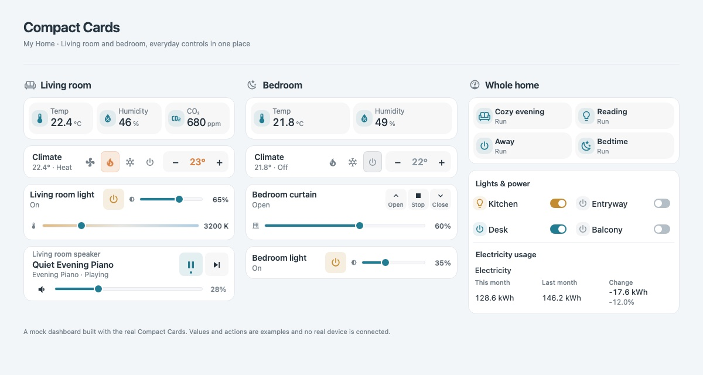
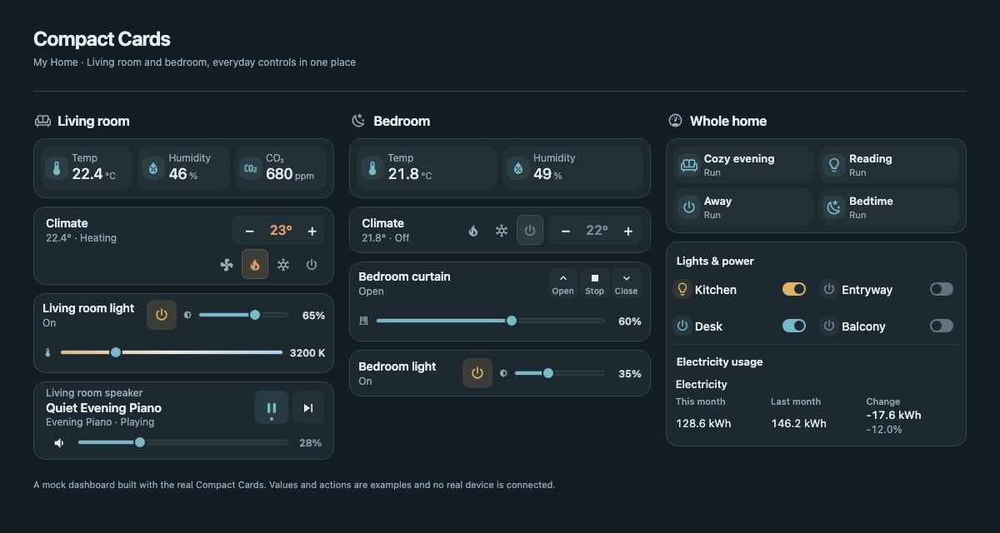

# Compact Cards for Home Assistant

Compact Home Assistant controls, arranged for a room. Read the state at a glance and adjust it directly on the card.

**English** | [한국어](README.ko.md)

[](https://github.com/eigger/hass-compact-cards/releases)
[](#installation)
[](https://github.com/eigger/hass-compact-cards/actions/workflows/check.yml)
[](LICENSE)
[](https://github.com/eigger/hass-compact-cards/releases)

## Features



*Rendered with the actual card JavaScript and mocked states. This is a local preview, not live-device verification.*

<details>
<summary>View the dark theme</summary>



</details>

Keep everyday controls close together: power, brightness, temperature, cover position and playback. Cards adapt to their available width and use Home Assistant theme colors. Configure them in the UI or YAML; all nine ship in one JavaScript file without a build step or external runtime libraries.

### Cards and guides

Guides provide options and YAML examples; existing control guides also include screenshots. Combine individual cards or embed controls in the home panel.

| Card / guide | Use | YAML type |
| --- | --- | --- |
| [Home panel](docs/compact-home-panel.md) | Room controls, sensors and usage comparisons | `custom:compact-home-panel` |
| [Climate](docs/compact-climate-row.md) | Icon-based modes and target temperature | `custom:compact-climate-row` |
| [Light](docs/compact-light-row.md) | Power, brightness and supported color temperature | `custom:compact-light-row` |
| [Cover](docs/compact-cover-row.md) | Open, stop, close and supported position | `custom:compact-cover-row` |
| [Scenes](docs/compact-scene-panel.md) | Scene and script shortcuts | `custom:compact-scene-panel` |
| [Environment](docs/compact-environment-panel.md) | Sensor readings and configured thresholds | `custom:compact-environment-panel` |
| [Media](docs/compact-media-row.md) | Playback, mute and supported volume controls | `custom:compact-media-row` |
| [Image](docs/compact-image-card.md) | Local/HTTP(S) images or image entities | `custom:compact-image-card` |
| [Camera](docs/compact-camera-card.md) | Camera thumbnail; tap for native details | `custom:compact-camera-card` |

[Interaction feedback](docs/polish.md) · [UX refinements](docs/ux-refinements.md) · [Light and cover setup](docs/light-cover.md) · [Scene and environment setup](docs/scene-environment.md)

## Installation

[](https://my.home-assistant.io/redirect/marketplace_repository/?owner=eigger&repository=hass-compact-cards&category=plugin)

Use Marketplace on Home Assistant 2026.11 or later.

1. Click the badge above, or enter <https://github.com/eigger/hass-compact-cards> in **Settings → Marketplace → Add from link**. Connect GitHub if prompted.
2. Select **Install** and reload the browser. If you manage resources in YAML, add the entry shown in the install dialog.
3. Add the card to your dashboard. [Quick start](#quick-start)

### Manual installation

1. Copy `compact-cards.js` from the [latest release](https://github.com/eigger/hass-compact-cards/releases/latest) to `/config/www/`. Create the folder if needed.
2. Add the URL below as a **JavaScript module** in dashboard resources and reload the browser. If you manage resources in YAML, add the entry to your existing resource list.

```yaml
url: /local/compact-cards.js
type: module
```

## Quick start

```yaml
type: custom:compact-climate-row
entity: climate.living_room
name: Living room climate
```

```yaml
type: custom:compact-home-panel
items:
  - type: heading
    name: Living room
  - entity: light.living_room
    name: Light
  - entity: sensor.living_room_temperature
    name: Temperature
  - type: climate
    entity: climate.living_room
    name: Climate
```

Replace entity IDs with those in your installation. More examples are available in [examples/dashboard.yaml](examples/dashboard.yaml).

All nine cards appear in the card picker and include a [visual configuration editor](docs/visual-editor.md). YAML configuration remains supported.

## Configuration

### `custom:compact-climate-row`

| Option | Description |
| --- | --- |
| `entity` | Required. A `climate.*` entity |
| `name` | Display name; defaults to the entity's name |

Only modes provided by the entity are displayed. Narrow cards move modes below the name and temperature instead of shrinking the buttons. Devices with more than three modes do so below 540px (640px with a coarse pointer), and touch controls use 44px targets. For devices supporting a single target temperature, −/+ respects the device's temperature step and minimum/maximum limits. Temperature buttons are disabled for devices that only support a high/low target range. Tap the name to open Home Assistant's entity details.

### `custom:compact-home-panel`

Set optional `columns` to `auto` (default), `1`, or `2` to control the ordinary entity layout. Combine the following entries in `items`. Ordinary entity entries use two columns and switch to one column at widths up to 380px; headings, notes, climate controls, comparisons, navigation and select entries use the full width.

| Entry | Fields and behavior |
| --- | --- |
| Entity | `entity`, optional `name`, `icon`. `light`/`switch` provide toggles, `lock` shows its state as a button (tap to lock or unlock), `select` provides option selection, and other domains display state |
| Sensor lookup by name | `find_name`, optional `domain` (defaults to `sensor`). Duplicate names within a domain are shown as unavailable. For state display |
| `type: heading` | `name`, optional `badges: [{entity: sensor.example, name: Temperature}]` |
| `type: note` | Note text in `name` |
| `type: climate` | `entity: climate.*`, optional `name` |
| `type: navigate` | `name`, `navigation_path: /dashboard-name/view`, optional `icon` |
| `type: comparison` | `rows` with `name`, `entity` (this month) and `previous` (last month) |

Usage comparisons read the current values and units of two sensors. They do not query monthly statistics or create sensors. Prepare a current-month cumulative sensor and a previous-month total sensor separately.

To run a button or script, add `tap_action` to an entity entry. `light`, `switch` and `select` use their dedicated controls, so command button configuration does not apply to those domains. A `lock` entry with a `perform-action` button shows that button instead of its state button.

```yaml
type: custom:compact-home-panel
items:
  - entity: script.good_night
    name: Good night
    tap_action:
      action: perform-action
      perform_action: script.turn_on
      target:
        entity_id: script.good_night
      confirmation:
        text: Run the good night script?
```

Pass service data using `data`. If `target` is omitted, the entry's `entity` is used as the target. Controls are disabled for unavailable entities.

## Important limitations

Built-in control labels and notifications currently use Korean. The minimum Home Assistant version and live device controls still need verification.

## Documentation

[Showcase configuration](examples/showcase.yaml) · [Room dashboard guide](docs/showcase.md) · [Visual editor](docs/visual-editor.md)

### Troubleshooting

- `Custom element doesn't exist`: Check the resource URL and JavaScript module type, then hard-refresh the browser. Register the resource for either the Marketplace or the manual installation.
- `확인 불가` (unavailable): Check the entity ID and its state. Controls do not operate while the state is `unknown` or `unavailable`, except that never-used buttons, scripts and scenes can be pressed while `unknown`.
- Change failure notification: Use Home Assistant developer tools to check that the entity supports the requested service.

### Development

- `compact-cards.js`: Card bundle without external runtime dependencies.
- `hacs.json`: Marketplace installation metadata.
- `examples/dashboard.yaml`: Example dashboard card configuration.
- `npm run check`: JavaScript syntax check (requires Node.js).
- `npm test`: DOM-based card behavior tests.

Development requires Node.js 22 or newer and `npm ci`. DOM tests use Happy DOM. Live Home Assistant rendering and device connectivity need separate verification.

```sh
npm ci
npm run check
npm test
```

The [shared check workflow](.github/workflows/check.yml) runs syntax checks and DOM tests on Node.js 22 and verifies the bundle on ordinary pushes and pull requests. Verify rendering and device behavior separately in a live Home Assistant instance.

Dependabot checks npm and GitHub Actions dependencies weekly and proposes updates to the central workflows in pull requests. Patch and minor updates can squash-merge automatically after required CI passes. Major updates require manual review. When a central workflow reference changes, update its version and resolved SHA in the standards record as well. [Standards record](STANDARDS.md) · [Verification record](ADOPTION_CHECKLIST.md)

The auto-merge workflow checks PR metadata and cleans up merged Dependabot branches. It never checks out PR code.

### Publishing

The bundle follows the [Marketplace dashboard card guide](https://contributors.home-assistant.io/marketplace/guides/dashboard/). `hacs.json` points to `compact-cards.js` in the repository root, so no build is required.

1. Commit and push the project to a GitHub repository.
2. Update the version in `package.json` and verify with `npm ci`, `npm run check` and `npm test`.
3. Commit the changes and push a matching version tag (the initial version was `v0.1.0`).
4. The [shared release workflow](.github/workflows/release.yml) validates the project, creates a GitHub release and attaches `compact-cards.js`. Actions must be enabled for the repository.

Syntax checks and tests also run on ordinary pushes and pull requests. Installing from the default branch without a release is supported.

Before pushing a tag, record user impact and required actions in the [changelog](CHANGELOG.md), and check Marketplace installation, browser rendering and actual device controls. The stable `vX.Y.Z` tag must match version `X.Y.Z` in `package.json`. Publish prereleases manually. Tests run with read access; only the separate job publishing the same commit receives write access.

## Support

- [Issues](https://github.com/eigger/hass-compact-cards/issues): bug reports and feature requests.
- [Discussions](https://github.com/eigger/hass-compact-cards/discussions): questions and shared experiences.
- [GitHub Sponsors](https://github.com/sponsors/eigger): support development.

## Related Projects

- [Overview Cards](https://github.com/eigger/hass-overview-cards) can embed home-panel rows in dashboard summaries.

## License

This project is licensed under the [MIT License](LICENSE).
