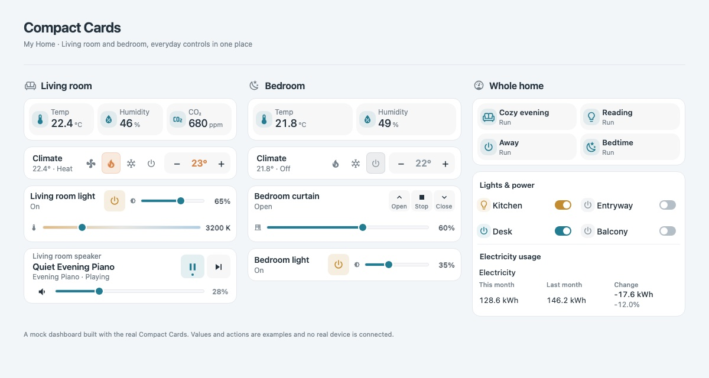
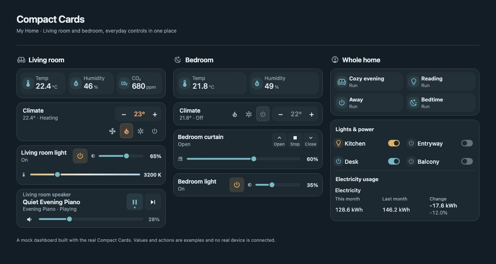

# Compact Cards

Compact Home Assistant controls, arranged for a room. Read the state at a glance and adjust it directly on the card.

**English** | [한국어](README.ko.md)



*Rendered with the actual card JavaScript and mocked states. This is a local preview, not live-device verification.*

<details>
<summary>View the dark theme</summary>



</details>

Keep everyday controls close together: power, brightness, temperature, cover position and playback. Cards adapt to their available width and use Home Assistant theme colors. Configure them in the UI or YAML; all nine ship in one JavaScript file without a build step or external runtime libraries.

[Showcase configuration](examples/showcase.yaml) · [Room dashboard guide](docs/showcase.md) · [Visual editor](docs/visual-editor.md)

## Cards and guides

Guides provide options and YAML examples; existing control guides also include screenshots. Combine individual cards or embed controls in the home panel.

| Card / guide | Use | YAML type |
| --- | --- | --- |
| [Home panel](docs/compact-home-panel.md) | Room controls, sensors and usage comparisons | `custom:compact-home-panel` |
| [Climate](docs/compact-climate-row.md) | Icon-based modes and target temperature | `custom:compact-climate-row` |
| [Light](docs/compact-light-row.md) | Power, brightness and supported color temperature | `custom:compact-light-row` |
| [Cover](docs/compact-cover-row.md) | Open, stop, close and supported position | `custom:compact-cover-row` |
| [Scenes](docs/compact-scene-panel.md) | Scene and script shortcuts | `custom:compact-scene-panel` |
| [Environment](docs/compact-environment-panel.md) | Sensor readings and configured thresholds | `custom:compact-environment-panel` |
| [Media](docs/compact-media-row.md) | Playback, mute and supported volume controls | `custom:compact-media-row` |
| [Image](docs/compact-image-card.md) | Local/HTTP(S) images or image entities | `custom:compact-image-card` |
| [Camera](docs/compact-camera-card.md) | Camera thumbnail; tap for native details | `custom:compact-camera-card` |

[Interaction feedback](docs/polish.md) · [UX refinements](docs/ux-refinements.md) · [Light and cover setup](docs/light-cover.md) · [Scene and environment setup](docs/scene-environment.md)

## HACS installation

Install [this repository](https://github.com/eigger/hass-compact-cards) through HACS **Custom repositories**. This project is not in the default HACS catalog.

1. Open HACS → top-right menu → Custom repositories.
2. Enter this project's GitHub repository URL and select **Dashboard**. Older HACS versions may show **Lovelace** or **Plugin**.
3. Find **Compact Cards**, download it, and refresh the browser.
4. Under Settings → Dashboards → Resources, check that the following resource is registered. Add it as a JavaScript module if missing. The Resources menu may require advanced mode.

```yaml
url: /hacsfiles/hass-compact-cards/compact-cards.js
type: module
```

This path assumes the GitHub repository is named `hass-compact-cards`. Adjust the path if you publish under another name. All cards are included in `compact-cards.js`.

## Manual installation

1. Copy `compact-cards.js` to `/config/www/compact-cards.js` in Home Assistant. Create the `www` directory if necessary.
2. Register `/local/compact-cards.js` as a JavaScript module in dashboard resources.
3. Refresh your browser and use the examples below in card configuration.

If you manage resources in YAML, add this entry to your existing resource list:

```yaml
url: /local/compact-cards.js
type: module
```

## Usage examples

```yaml
type: custom:compact-climate-row
entity: climate.living_room
name: Living room climate
```

```yaml
type: custom:compact-home-panel
items:
  - type: heading
    name: Living room
  - entity: light.living_room
    name: Light
  - entity: sensor.living_room_temperature
    name: Temperature
  - type: climate
    entity: climate.living_room
    name: Climate
```

Replace entity IDs with those in your installation. More examples are available in [examples/dashboard.yaml](examples/dashboard.yaml).

All nine cards appear in the card picker and include a [visual configuration editor](docs/visual-editor.md). YAML configuration remains supported.

Built-in control labels and notifications currently use Korean.

## Configuration

### `custom:compact-climate-row`

| Option | Description |
| --- | --- |
| `entity` | Required. A `climate.*` entity |
| `name` | Display name; defaults to the entity's name |

Only modes provided by the entity are displayed. Narrow cards move modes below the name and temperature instead of shrinking the buttons. Devices with more than three modes do so below 540px (640px with a coarse pointer), and touch controls use 44px targets. For devices supporting a single target temperature, −/+ respects the device's temperature step and minimum/maximum limits. Temperature buttons are disabled for devices that only support a high/low target range. Tap the name to open Home Assistant's entity details.

### `custom:compact-home-panel`

Set optional `columns` to `auto` (default), `1`, or `2` to control the ordinary entity layout. Combine the following entries in `items`. Ordinary entity entries use two columns and switch to one column at widths up to 380px; headings, notes, climate controls, comparisons, navigation and select entries use the full width.

| Entry | Fields and behavior |
| --- | --- |
| Entity | `entity`, optional `name`, `icon`. `light`/`switch` provide toggles, `select` provides option selection, and other domains display state |
| Sensor lookup by name | `find_name`, optional `domain` (defaults to `sensor`). Duplicate names within a domain are shown as unavailable. For state display |
| `type: heading` | `name`, optional `badges: [{entity: sensor.example, name: Temperature}]` |
| `type: note` | Note text in `name` |
| `type: climate` | `entity: climate.*`, optional `name` |
| `type: navigate` | `name`, `navigation_path: /dashboard-name/view`, optional `icon` |
| `type: comparison` | `rows` with `name`, `entity` (this month) and `previous` (last month) |

Usage comparisons read the current values and units of two sensors. They do not query monthly statistics or create sensors. Prepare a current-month cumulative sensor and a previous-month total sensor separately.

To run a button or script, add `tap_action` to an entity entry. `light`, `switch` and `select` use their dedicated controls, so command button configuration does not apply to those domains.

```yaml
type: custom:compact-home-panel
items:
  - entity: script.good_night
    name: Good night
    tap_action:
      action: perform-action
      perform_action: script.turn_on
      target:
        entity_id: script.good_night
      confirmation:
        text: Run the good night script?
```

Pass service data using `data`. If `target` is omitted, the entry's `entity` is used as the target. Controls are disabled for unavailable entities.

## Publishing

The HACS layout follows the [official publishing documentation](https://hacs.dev/docs/publish/start/). `hacs.json` points to `compact-cards.js` in the repository root; no build is required.

1. Commit and push the project to a GitHub repository.
2. Update the version in `package.json` and verify with `npm ci`, `npm run check` and `npm test`.
3. Commit the changes and push a matching version tag (initial version: `v0.1.0`).
4. GitHub Actions validates the project, creates a Release and attaches `compact-cards.js`. Actions must be enabled for the repository.

Syntax checks and tests also run on ordinary pushes and pull requests. Installing from the default branch without a release is supported.

Before pushing a tag, record user impact and required actions in the [changelog](CHANGELOG.md), and check HACS installation, browser rendering and actual device controls. The tag and `package.json` must identify the same stable `vX.Y.Z` version. Tests run with read access; only the separate job publishing the same commit receives write access.

## Troubleshooting

- `Custom element doesn't exist`: Check the resource URL and JavaScript module type, then hard-refresh the browser. Avoid registering both HACS and manual installation resources.
- `확인 불가` (unavailable): Check the entity ID and its state. Controls do not operate while the state is `unknown` or `unavailable`.
- Change failure notification: Use Home Assistant developer tools to check that the entity supports the requested service.

## Local development

- `compact-cards.js`: Card bundle without external runtime dependencies.
- `hacs.json`: HACS installation metadata.
- `examples/dashboard.yaml`: Example dashboard card configuration.
- `npm run check`: JavaScript syntax check (requires Node.js).
- `npm test`: DOM-based card behavior tests.

Development requires Node.js 22 or newer and `npm ci`. DOM tests use Happy DOM. Live Home Assistant rendering and device connectivity need separate verification.

```sh
npm ci
npm run check
npm test
```

Dependabot proposes development-tool and GitHub Actions updates weekly. Patch and minor updates can squash auto-merge after required CI passes; major updates require manual review. The shared metadata-only workflow also cleans up merged Dependabot branches. It never checks out PR code with write permissions. See [STANDARDS.md](STANDARDS.md) for the scope of the standards reference and [verification notes](ADOPTION_CHECKLIST.md) for the actual environment and outstanding checks.

## Support

- [Issues](https://github.com/eigger/hass-compact-cards/issues): bug reports and feature requests.
- [Discussions](https://github.com/eigger/hass-compact-cards/discussions): questions and shared experiences.
- [GitHub Sponsors](https://github.com/sponsors/eigger): support development.
