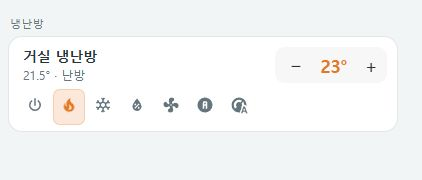
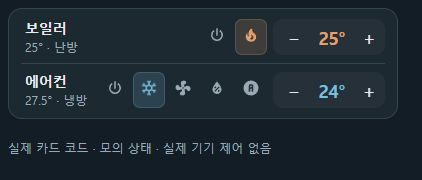
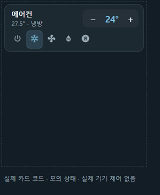
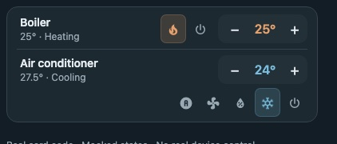
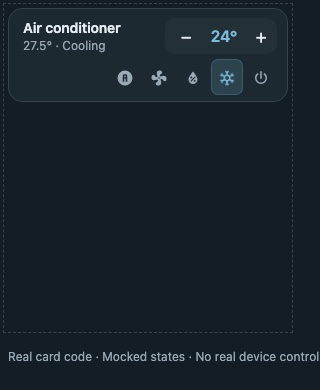

# Compact climate row — 냉난방

[UI에서 구성하기](visual-editor.md) · 아래 YAML 예제도 동일하게 사용할 수 있습니다.



운전 모드와 설정 온도를 바로 조작하는 냉난방 카드입니다. 이름 아래에 현재 상태와 현재 온도를 표시하고, 지원 모드만 버튼으로 제공합니다. 이미지는 모의 상태를 사용하는 로컬 미리보기입니다. 기기의 지원 모드·속성과 카드 너비에 따라 실제 화면은 달라집니다.

## 시작하기

먼저 [설치 가이드](../README.ko.md#hacs-설치)에 따라 `compact-cards.js` 리소스를 등록하세요. 대시보드의 수동 카드 또는 YAML 편집기에 다음 구성을 추가하고 엔티티 ID를 실제 기기로 변경합니다.

```yaml
type: custom:compact-climate-row
entity: climate.living_room
name: 거실 냉난방
```

카드 추가 화면에서는 **Compact climate row**를 선택할 수 있습니다. 시각적 설정 편집기와 YAML 편집기를 모두 사용할 수 있습니다.

## 설정 옵션

| 옵션 | 필수 | 기본값 / 설명 |
| --- | --- | --- |
| `type` | 예 | `custom:compact-climate-row` |
| `entity` | 예 | 제어할 `climate.*` 엔티티 |
| `name` | 아니요 | 엔티티의 표시 이름. 이름이 없으면 엔티티 ID |
| `embedded` | 아니요 | 기본 `false`. 홈 패널 내부에서 테두리와 여백을 줄일 때 자동 적용되는 내부 배치 옵션. 독립 카드에서는 생략 권장 |

모드 목록, 온도 간격, 온도 범위는 YAML에서 복제하지 않고 엔티티 속성을 따릅니다. 색상은 Home Assistant 테마의 냉난방 상태 색상을 사용합니다.

## 조작 방법

| 조작 | 동작 |
| --- | --- |
| 이름·상태 영역 누르기 | Home Assistant 상세 정보 열기 |
| 모드 아이콘 누르기 | 해당 운전 모드 요청. 현재 모드는 배경색과 선택 상태로 구분 |
| `−` / `+` 누르기 | 설정 온도를 기기의 `target_temp_step`만큼 변경 |
| 키보드 Tab 후 Enter 또는 Space | 선택한 버튼 실행 |

모드 버튼은 아이콘 중심으로 유지하여 시각적 밀도를 줄입니다. 현재 모드는 이름 아래 상태 텍스트와 선택 강조로 확인하며, 각 버튼은 툴팁과 접근성 이름으로 의미를 제공합니다.

모드 버튼은 오른쪽 정렬하며 왼쪽부터 자동 → 냉난방 자동 → 송풍 → 제습 → 난방 → 냉방 → 전원(끄기) 순서로, 기기가 지원하는 항목만 표시합니다. 보일러는 난방 → 전원, 에어컨은 자동 → 송풍 → 제습 → 냉방 → 전원으로 정렬되어 전원이 온도 조절부 바로 앞에 놓입니다. 다른 모드는 표준 모드 앞에 기기가 제공한 순서로 표시합니다. 모드가 아래 줄로 이동할 때도 오른쪽 정렬을 유지합니다.

기기에서 간격을 제공하지 않으면 섭씨는 0.5도, 화씨는 1도씩 변경합니다. 최솟값·최댓값을 넘지 않으며, 해당 한계의 방향 버튼은 비활성화됩니다. 현재 온도는 기기가 `current_temperature`를 제공할 때만 표시합니다.

운전 모드는 `off`, `heat`, `cool`, `dry`, `fan_only`, `auto`, `heat_cool` 중 엔티티가 제공하는 항목을 표시합니다. 다른 모드 값은 일반 온도조절기 아이콘과 원래 모드 이름으로 표시합니다. 모든 모드가 모든 기기에 표시되는 것은 아닙니다.

단일 목표 온도 기능을 지원하고 숫자 `temperature`가 있을 때만 `−` / `+`를 사용할 수 있습니다. 상한·하한 온도 범위만 지원하는 기기에서는 온도 버튼이 비활성화됩니다. 팬 속도·스윙·프리셋·범위 온도 등은 이름을 눌러 상세 정보에서 조작하세요.

## 좁은 카드와 터치 환경



위 예시는 실제 카드 코드와 모의 상태를 사용하는 390px 홈 패널입니다. 보일러의 두 모드와 에어컨의 다섯 모드가 각각 한 줄로 배치됩니다. 현재 온도를 보조 텍스트 앞에 표시해 좁은 이름 영역에서도 숫자를 먼저 읽을 수 있으며, 전체 상태는 툴팁과 접근성 이름으로 제공합니다.

이름 공간과 실제 모드 버튼·온도 조작부의 너비를 확인하여, 공간이 충분하면 한 줄로 표시합니다. 고정된 화면 너비나 모드 개수만으로 두 줄을 만들지 않습니다. 한 줄에 들어가지 않을 때만 모드 버튼을 이름·온도 아래로 옮기며, 아래 줄에서도 공간이 부족하면 버튼을 감쌉니다.

기기가 제공하는 모든 모드 버튼을 아이콘 중심으로 유지합니다. 줄을 줄이기 위해 모드를 숨기거나 드롭다운으로 바꾸지 않습니다. 터치 환경의 조작 영역은 세로 44px를 유지하고, 한 줄에 들어가도록 가로만 32~44px 범위에서 실제 남는 폭에 맞춰 줄입니다. 홈 패널 안에서는 모든 냉난방 줄이 가장 작은 값을 함께 사용하여 보일러와 에어컨의 버튼 크기가 같습니다. 같은 너비라도 기기의 모드 수와 실제 조작부 너비에 따라 한 줄 또는 여러 줄로 배치될 수 있습니다.

카드 본문은 내용에 필요한 높이를 사용하며, 편집 미리보기의 빈 높이를 채우기 위해 늘어나지 않습니다. 대시보드에서 카드 바깥에 별도로 지정한 그리드 행 높이나 여백은 대시보드 배치 설정에 따라 남을 수 있습니다.

터치 환경의 모드·온도 버튼은 세로 44px, 가로 최대 44px 조작 영역을 사용합니다. 지원하는 기기에서는 실제 운전 동작에 따라 아이콘이 움직이고, 운영체제의 동작 줄이기 설정에서는 애니메이션을 중지합니다.

서비스 요청 중에는 모드·온도 제어를 비활성화하고 조작부를 살짝 흐리게 표시하여 처리 중임을 알립니다. 요청이 끝나면 다시 조작할 수 있습니다. 서비스 응답과 기기의 실제 상태 갱신 시점은 통합에 따라 다르며, 화면 상태는 Home Assistant가 보고한 값으로 표시합니다. 요청 실패 시 알림을 표시하고 버튼을 복구합니다.

<details>
<summary>고정 높이 부모 안의 카드 미리보기</summary>



점선은 280 × 320px 모의 미리보기 부모이며, 내부 카드의 CSS는 실제 구현 그대로입니다. 카드가 부모 높이를 채우지 않고 내용 높이만 사용합니다. `examples/climate-fit.html`에서 재현할 수 있으며 실제 HA 연결 화면은 아닙니다.

</details>

## 홈 패널에 넣기

```yaml
type: custom:compact-home-panel
items:
  - type: heading
    name: 거실
  - type: climate
    entity: climate.living_room
    name: 냉난방
```

패널에서는 같은 냉난방 구현을 사용하며 외곽 테두리와 여백을 줄입니다. `embedded`를 직접 지정할 필요는 없습니다. 자세한 구성은 [홈 패널 가이드](compact-home-panel.md)를 참고하세요.

## 표시가 예상과 다를 때

- `확인 불가`: 엔티티가 없거나 `unknown` / `unavailable` 상태인지 확인합니다. 이 상태에서는 제어하지 않습니다.
- 온도에 `—`가 표시됨: 엔티티에 숫자 목표 온도가 있는지 확인합니다.
- 특정 모드가 없음: 기기가 제공하는 `hvac_modes`를 확인합니다. 카드가 지원하지 않는 기기 기능을 추가하지는 않습니다.
- 명령 실패: Home Assistant 개발자 도구에서 같은 기기의 냉난방 서비스를 실행할 수 있는지 확인합니다.

## English






Use `custom:compact-climate-row` with a required `climate.*` `entity` and optional `name`. Tap the name to open more-info; mode buttons request supported HVAC modes, and −/+ follows the device step and limits. A single target-temperature feature and a numeric temperature are required for temperature controls. Range-only thermostats need more-info for range adjustment.

The card keeps the name, modes and temperature on one line whenever their measured widths fit. Modes move below the name and temperature only when needed, then wrap if necessary. All supported mode buttons remain visible and icon-centered; coarse-pointer controls retain 44px targets. The card uses its content height instead of stretching to fill editor preview space; dashboard grid settings may still reserve external space. Controls disable and dim subtly during service requests, then recover after success or failure. Reported state comes from Home Assistant. Embed the same card using `type: climate` in a home panel. The representative image uses mocked local preview data.
