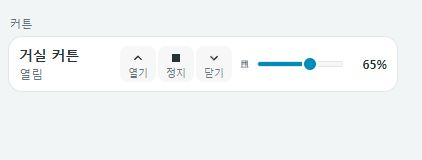
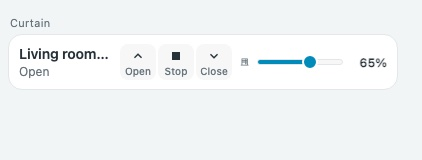

# Compact cover row · 커튼

[UI에서 구성하기](visual-editor.md) · 아래 YAML 예제도 동일하게 사용할 수 있습니다.



모의 상태로 렌더링한 대표 이미지입니다. 열기·정지·닫기와 열림 위치를 직접 조작하는 커튼·블라인드 행입니다.

## 기본 예제

```yaml
type: custom:compact-cover-row
entity: cover.living_room
name: 거실 커튼
```

| 옵션 | 필수 | 설명 |
| --- | --- | --- |
| `entity` | 예 | `cover.*` 엔티티 |
| `name` | 아니요 | 생략하면 엔티티 표시 이름 |

## 조작과 지원 범위

기기가 지원하는 열기·정지·닫기 버튼만 표시합니다. 위치 조절을 지원하면 0–100% 슬라이더를 표시합니다. 0%는 완전히 닫힘, 100%는 완전히 열림입니다. 위치를 보고하지 않으면 `—`를 표시하며, 지원되는 위치 조절 자체는 사용할 수 있습니다. 틸트·각도·속도 제어는 이 카드에 포함하지 않습니다.

버튼 안의 `열기 / 정지 / 닫기` 레이블로 동작을 구분합니다. 레이블은 기존 버튼 영역 안에 표시하여 별도 설명 행을 추가하지 않습니다.

이동 명령이 처리 중이어도 정지 버튼은 사용할 수 있습니다. 정지 요청 자체가 처리 중이면 같은 정지 요청을 중복 전송하지 않습니다. 명령 완료는 서비스 요청의 완료이며 실제 커튼의 이동 완료를 보장하지 않습니다. 현재 상태와 위치는 기기가 Home Assistant에 보고한 값을 표시합니다.

슬라이더는 이동 중 숫자를 즉시 표시하고 놓을 때 한 번 전송합니다. 요청 값은 기기 보고가 일치하거나 요청 후 유지 시간이 끝날 때까지 잠시 유지됩니다. 연결 불가 상태는 비활성화하고, 실패 시 알림과 실제 값으로 복구합니다. 이름은 상세 정보를 엽니다.

## 홈 패널 안에 넣기

```yaml
type: custom:compact-home-panel
items:
  - type: heading
    name: 창가
  - type: cover
    entity: cover.living_room
    name: 거실 커튼
  - entity: sensor.living_room_illuminance
    name: 조도
```

좁은 카드에서는 위치 슬라이더가 다음 줄로 이동하고 터치 환경에서도 버튼 조작 영역을 유지합니다.

## English



Use `custom:compact-cover-row` with required cover entity and optional name. Open/stop/close/position controls are capability-aware. Position means 0 closed, 100 open. Stop remains usable during an in-flight motion request; request completion does not imply movement completion. Sliders commit once on release and preserve requested values while awaiting device state. Embed using `type: cover` in a home panel. The representative screenshot uses mocked state.
