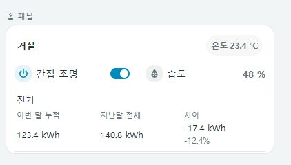
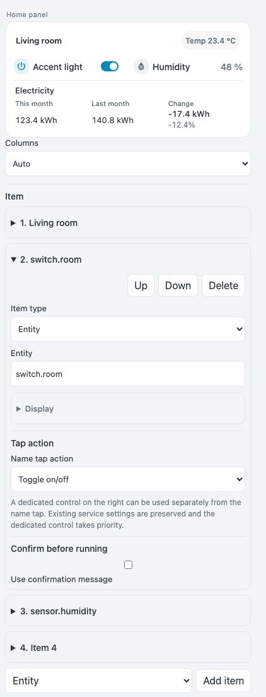

# Compact home panel — 홈 패널

[UI에서 구성하기](visual-editor.md) · 아래 YAML 예제도 동일하게 사용할 수 있습니다.



조명·스위치·센서·냉난방·사용량 비교·실행 버튼을 한 패널에 묶습니다. 일반 항목은 두 열로 묶고, 자세한 조작이 필요한 행은 전체 너비를 사용합니다. 이미지는 모의 상태를 사용하는 로컬 미리보기이며 설정과 카드 너비에 따라 실제 화면은 달라집니다.

## 대표 예제

[리소스를 설치](../README.ko.md#hacs-설치)한 뒤 카드 선택 화면에서 추가하고 UI로 구성하거나 아래 YAML을 사용합니다. 모든 엔티티 ID와 탐색 경로는 실제 환경에 맞게 변경하세요.

```yaml
type: custom:compact-home-panel
columns: auto
items:
  - type: heading
    name: 거실
    badges:
      - entity: sensor.living_room_temperature
        name: 온도
  - entity: switch.accent_light
    name: 간접 조명
  - entity: sensor.living_room_humidity
    name: 습도
  - type: light
    entity: light.living_room
    name: 메인 조명
  - type: cover
    entity: cover.living_room
    name: 커튼
  - type: climate
    entity: climate.living_room
    name: 냉난방
  - type: navigate
    name: 에너지 대시보드
    navigation_path: /energy
```

카드 추가 화면에서는 **Compact home panel**을 선택할 수 있습니다. UI 편집기와 YAML 편집기를 모두 사용할 수 있습니다.

## 패널 옵션

| 옵션 | 필수 | 기본값 / 설명 |
| --- | --- | --- |
| `type` | 예 | `custom:compact-home-panel` |
| `items` | 예 | 아래 항목을 순서대로 담는 배열 |
| `columns` | 아니요 | `auto`. 일반 항목을 두 열로 표시하고 카드 너비 380px 이하에서는 한 열로 전환. 숫자 `1` / `2`로 고정 가능 |

`columns`는 일반 항목에만 적용합니다. 제목·메모·냉난방·상세 조명·커튼·사용량 비교·탐색과 `select.*`는 전체 너비를 사용합니다. 좁은 카드에서 긴 이름과 값을 읽어야 한다면 `auto` 또는 `1`을 사용하세요.

## 일반 엔티티

```yaml
type: custom:compact-home-panel
items:
  - entity: light.desk
    name: 책상 조명
    icon: mdi:desk-lamp
  - entity: sensor.room_temperature
    name: 실내 온도
  - entity: select.air_purifier_preset
    name: 공기청정기 프리셋
```

| 필드 | 설명 |
| --- | --- |
| `entity` | 엔티티 ID. 이름 검색을 사용하지 않는 일반 항목에 필요 |
| `name` | 선택. 표시 이름. 생략하면 엔티티 이름 또는 ID |
| `icon` | 선택. `mdi:...` 아이콘. 생략하면 Home Assistant의 엔티티 아이콘을 사용하며, 사용자 지정 아이콘·기기 종류·현재 상태를 반영 |
| `tap_action` | 선택. 이름 터치 동작 또는 오른쪽 서비스 실행 버튼 설정 |

`type`을 생략한 `light.*` / `switch.*`는 전원 토글을 표시합니다. `select.*`는 옵션 선택을 표시하고, 나머지는 상태를 표시합니다. 밝기·색온도까지 조작하려면 일반 조명 항목 대신 `type: light`를 사용하세요. `input_select.*`는 이 전용 선택 제어의 대상이 아닙니다.

기본적으로 일반 항목의 이름을 누르면 상세 정보가 열립니다. `tap_action.action: toggle`을 지정하면 이름을 눌러 해당 엔티티를 전환하고, `more-info`를 지정하면 상세 정보를 엽니다. 오른쪽 전용 토글·옵션 선택은 이름 터치 동작과 별개로 유지됩니다. 없는 엔티티와 `unknown` / `unavailable` 상태에서는 제어를 비활성화하지만, 존재하는 엔티티의 상세 정보는 상태를 확인할 수 없어도 열 수 있습니다.

## 이름 터치 동작

```yaml
type: custom:compact-home-panel
items:
  - entity: switch.desk_light
    name: 책상 조명
    tap_action:
      action: toggle
      confirmation:
        text: 책상 조명을 전환할까요?
  - entity: sensor.room_temperature
    name: 실내 온도
    tap_action:
      action: more-info
```

| `tap_action.action` | 이름을 눌렀을 때 | 오른쪽 조작 |
| --- | --- | --- |
| 생략 | 상세 정보 | 엔티티 종류에 따른 기본 제어 또는 상태 |
| `more-info` | 상세 정보 | 기존 전용 제어 또는 상태 유지 |
| `toggle` | 항목의 `entity`를 `homeassistant.toggle`로 전환 | 기존 전용 제어 또는 상태 유지 |
| `perform-action` | 상세 정보 | 지원되는 일반 항목에 별도의 `실행` 버튼 |

`toggle`은 `type`을 생략하고 `entity`를 명시한 일반 항목에 사용합니다. `find_name`만으로 찾는 항목에는 사용할 수 없습니다. 지정한 엔티티 자체가 전환 대상이며, 별도 `target`이나 `data`로 대상을 바꾸지 않습니다. 해당 엔티티에서 토글 서비스를 지원해야 합니다.

`toggle`의 선택적 `confirmation.text`는 이름과 오른쪽 전용 토글 양쪽에 적용됩니다. 확인을 취소하면 전환하지 않으며, 요청 중 중복 전환과 연결 불가 상태의 전환을 막습니다. `more-info`는 기기 제어 서비스를 호출하지 않고 존재하는 엔티티의 상세 정보를 엽니다.

<details>
<summary>UI에서 이름 터치 동작 선택하기</summary>


실제 카드 코드와 모의 상태를 사용하는 로컬 편집 예시입니다.

</details>

## 이름으로 센서 찾기

```yaml
type: custom:compact-home-panel
items:
  - find_name: 거실 온도
    domain: sensor
    name: 온도
```

`find_name`은 엔티티의 표시 이름과 정확히 일치하는 대상을 찾습니다. `domain` 기본값은 `sensor`입니다. 같은 도메인에 같은 이름이 여러 개면 임의로 선택하지 않고 `확인 불가`로 표시합니다. `entity`와 함께 지정하면 명시한 `entity`가 우선합니다. 이름 검색은 상태 표시용이며 직접 제어할 항목은 `entity`로 지정하세요.

## 제목·배지·메모

```yaml
type: custom:compact-home-panel
items:
  - type: heading
    name: 침실
    badges:
      - entity: sensor.bedroom_temperature
        name: 온도
      - entity: sensor.bedroom_humidity
        name: 습도
  - type: note
    name: 취침 전 조명과 커튼을 확인하세요.
```

`heading`과 `note`는 `name`이 필요합니다. 제목의 선택적 `badges`는 `{entity, name}` 목록이며, 배지의 `name`을 생략하면 엔티티 이름을 사용합니다. 배지는 이름과 값을 함께 표시하고 누르면 센서 상세 정보가 열립니다. 배지가 많으면 다음 줄로 감쌉니다. 메모는 일반 텍스트이며 Markdown을 렌더링하지 않습니다.

## 상세 제어 행

| 항목 유형 | 필수 필드 | 선택 필드 / 동작 |
| --- | --- | --- |
| `type: climate` | `entity: climate.*` | `name`. 지원 운전 모드·단일 목표 온도 제어 |
| `type: light` | `entity: light.*` | `name`. 전원·지원 밝기·지원 색온도 제어 |
| `type: cover` | `entity: cover.*` | `name`. 지원 열기·정지·닫기·위치 제어 |

독립 카드와 같은 구현을 사용하며 패널에 맞춰 외곽선과 여백을 줄입니다. 기기가 지원하지 않는 기능은 표시하지 않거나 비활성화합니다. [냉난방 가이드](compact-climate-row.md)와 [조명·커튼 가이드](light-cover.md)에서 자세한 조작을 확인하세요.

## 사용량 비교

```yaml
type: custom:compact-home-panel
items:
  - type: heading
    name: 에너지
  - type: comparison
    rows:
      - name: 전기
        entity: sensor.electricity_this_month
        previous: sensor.electricity_last_month
      - name: 수도
        entity: sensor.water_this_month
        previous: sensor.water_last_month
```

`comparison.rows`는 비교 행 목록입니다. 각 행의 `entity`는 이번 달 값, `previous`는 지난달 값으로 사용할 엔티티이며 둘 다 필요합니다. `name`은 행 이름으로 지정하는 것을 권장합니다. 값 버튼을 누르면 각각의 센서 상세 정보가 열립니다.

카드는 두 센서의 **현재 숫자 값과 단위**를 비교합니다. 월별 통계를 조회하거나 센서를 만들지 않으므로 이번 달 누적·지난달 전체 센서를 별도로 준비해야 합니다. 차이는 `현재 − 이전`, 증감률은 `(현재 − 이전) / 이전 × 100`입니다. 이전 값이 0 이하이면 증감률을 계산하지 않습니다. 숫자가 없거나 단위가 다르면 그 이유를 표시합니다. 단위 변환은 하지 않습니다.

이번 달 누적과 지난달 전체는 측정 기간이 다르므로, 증감을 같은 기간의 사용 추세로 해석하지 않도록 주의하세요. 카드 너비 420px 이하에서는 항목명 아래에 이번 달 누적·지난달 전체·차이를 묶어 표시합니다. 기간은 숫자에 직접 연결되는 열 이름으로 표시하고 반복 설명 행은 생략합니다.

## 서비스 실행 버튼

```yaml
type: custom:compact-home-panel
items:
  - entity: script.good_night
    name: 취침 모드
    icon: mdi:weather-night
    tap_action:
      action: perform-action
      perform_action: script.turn_on
      target:
        entity_id: script.good_night
      data: {}
      confirmation:
        text: 취침 모드를 실행할까요?
```

| 필드 | 설명 |
| --- | --- |
| `tap_action.action` | 이 실행 버튼 예제에서는 `perform-action`. 이름 터치는 위의 `toggle`, `more-info`도 지원 |
| `tap_action.perform_action` | `perform-action`일 때 필수. `domain.service` 형식의 서비스 이름 |
| `tap_action.target` | `perform-action`의 선택 항목. Home Assistant 대상 객체. 생략하면 항목의 `entity` |
| `tap_action.data` | `perform-action`의 선택 항목. 서비스 데이터 객체. 기본 빈 객체 |
| `tap_action.confirmation` | 선택. 확인을 요청하는 객체 |
| `tap_action.confirmation.text` | 선택. 확인 메시지. 생략하면 기본 확인 문구 |

이 설정은 일반 항목 오른쪽에 `실행` 버튼을 추가합니다. `light` / `switch` / `select`의 일반 항목은 오른쪽 전용 제어가 우선하므로 별도의 서비스 실행 버튼을 추가하지 않습니다. `perform-action`에서 이름은 실행 버튼과 별도로 상세 정보를 엽니다.

이 패널의 지원 범위는 `toggle`, `more-info`, `perform-action`입니다. Home Assistant의 전체 액션 스키마를 구현하지 않으며 `tap_action.action: navigate`, 길게 누르기, 두 번 누르기는 지원하지 않습니다. 탐색은 아래의 `type: navigate` 항목을 사용하세요.

일반 항목의 `unknown` 상태는 실행할 수 없습니다. 한 번도 실행하지 않은 장면도 바로 실행하려면 전용 [장면 패널](scene-environment.md)을 사용하세요.

## 대시보드 탐색

```yaml
type: custom:compact-home-panel
items:
  - type: navigate
    name: 침실 대시보드
    icon: mdi:bed-outline
    navigation_path: /dashboard-home/bedroom
```

`name`과 `navigation_path`가 필요하며 `icon`은 선택입니다. 이름 또는 `열기` 버튼을 누르면 해당 경로로 이동합니다. 경로는 `/`로 시작하는 Home Assistant 내부 경로여야 하며 `//`, 공백, 역슬래시는 허용하지 않습니다. 외부 URL은 지원하지 않습니다.

## 조작감과 상태 표시

서비스 요청 중에는 해당 엔티티의 제어만 비활성화하고 처리 중 표시를 제공합니다. 다른 엔티티는 계속 조작할 수 있습니다. 실패하면 알림을 표시하고 제어를 복구합니다. 실제 상태 갱신 지연은 기기와 통합에 따라 다릅니다. 터치 환경에서는 제어 높이를 최소 44px로 늘리며, 키보드 포커스를 표시하고 동작 줄이기 설정을 반영합니다.

카드가 비어 보이면 `items` 목록과 실제 엔티티 ID를 먼저 확인하세요. `확인 불가`는 엔티티 누락·연결 불가·이름 검색 중복 등으로 발생할 수 있습니다. 서비스 실패는 Home Assistant 개발자 도구에서 같은 서비스를 실행해 확인할 수 있습니다.

## English




Use `custom:compact-home-panel` with an `items` array. Optional `columns` accepts `auto` (default), `1`, or `2`; automatic entity rows collapse to one column at 380px. Full-width headings, notes, select controls, comparisons, navigation, and `type: climate/light/cover` rows keep their own layouts.

Plain light/switch entities show toggles, `select.*` shows an option selector, and other entities show state. Names open more-info by default, including with legacy `perform-action` configurations. Explicit `tap_action.action: toggle` makes the name call `homeassistant.toggle` for that item's own explicit `entity`; name-only lookup cannot toggle. Optional toggle confirmation applies to both the name and the dedicated right-hand toggle. Explicit `more-info` opens details without calling a service, including for an existing unknown/unavailable entity. Right-hand dedicated controls remain separate. Use `find_name` with optional `domain` for read-only exact-name lookup; duplicates are unavailable. Headings accept named entity badges. Notes are plain text.

Comparisons require existing numeric `entity` and `previous` sensors with identical units. They compare current sensor values, do not fetch history or create monthly sensors, and cannot calculate percentage change from a zero or negative previous value. Service buttons accept `perform-action`, a `domain.service` name, optional `target`, `data`, and confirmation text. Supported tap actions are limited to `toggle`, `more-info`, and `perform-action`; hold/double-tap and the full HA action schema are not implemented. Navigation uses `type: navigate` with local paths only. Controls show busy feedback, disable duplicate requests, and report failures. The representative image uses mocked local preview data.
