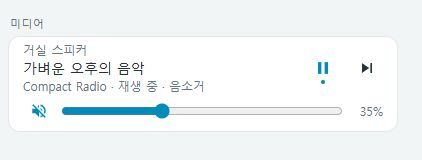

# Compact media row · 미디어

[UI에서 구성하기](visual-editor.md) · 아래 YAML 예제도 동일하게 사용할 수 있습니다.


모의 상태로 렌더링한 대표 이미지입니다. 곡명·아티스트와 재생·다음 곡·음량을 표시하며, 큰 앨범 아트 없이 자주 쓰는 조작에 공간을 집중합니다.

## 기본 예제

```yaml
type: custom:compact-media-row
entity: media_player.living_room
name: 거실 스피커
show_volume: true
show_next: true
```

| 옵션 | 기본값 | 설명 |
| --- | --- | --- |
| `entity` | 필수 | `media_player.*` 엔티티 |
| `name` | 엔티티 이름 | 표시 이름 |
| `show_volume` | `true` | 지원 시 음량 슬라이더 표시 |
| `show_next` | `true` | 지원 시 다음 곡 표시 |

## 조작

- 이름·곡 정보: Home Assistant 상세 정보.
- 재생 중: 일시정지. 일시정지·대기 중: 재생. 꺼짐·대기 전원 상태: 지원 시 전원 켜기.
- 다음 곡: 기기가 지원하고 설정에서 숨기지 않았을 때 표시.
- 음량: 0–100%, 변경 확정 시 `volume_set` 한 번 전송.
- 음량 아이콘: 음소거 상태를 표시하며 기기가 지원하고 현재 음소거 상태가 확인되면 같은 자리에서 음소거·해제를 한 번에 조작합니다.

음량 설정 없이 음소거만 지원하는 기기에서는 음소거 버튼을 재생 버튼과 같은 행에 표시하여 빈 음량 행을 만들지 않습니다. `show_volume: false`는 이 음소거 버튼도 숨깁니다.

지원하지 않는 기능은 숨깁니다. 음량 설정 기능이 있어도 현재 음량을 보고하지 않으면 슬라이더를 비활성화하고 `—`를 표시합니다. 전원이 꺼진 기기의 다음 곡·음량은 사용할 수 없습니다. 전원 켜기만 지원한다면 같은 버튼 자리에서 전원을 켤 수 있습니다.

음량 드래그와 키보드 조절 중에는 외부 상태 갱신이 편집 값을 덮어쓰지 않습니다. 전송 후 요청 값은 최대 3초 동안 유지되어 기기 보고 지연에 따른 튀는 현상을 줄입니다. 실패하면 알림과 실제 상태로 돌아옵니다. 음량·음소거와 재생 조작은 각각 중복 요청을 막습니다. 음량 요청을 기다리는 중에도 일시정지·다음 곡을 조작할 수 있습니다. 음소거 중에는 상태 문구와 아이콘으로 알리며 음소거 제어를 지원하지 않아도 상태를 표시합니다. `show_volume: false`는 음량 행 전체를 숨기지만 상태 문구의 음소거 표시는 유지합니다.



## 더 작은 구성

```yaml
type: custom:compact-media-row
entity: media_player.bedroom
name: 침실
show_volume: false
show_next: false
```

이 구성은 곡 정보와 재생 조작만 표시합니다. 긴 곡명은 말줄임하고 툴팁과 상세 정보에서 확인합니다. 터치 환경의 조작 영역과 키보드 포커스를 유지합니다.

## 홈 패널 안에 넣기

```yaml
type: custom:compact-home-panel
items:
  - type: media
    entity: media_player.living_room
    name: 거실 스피커
    show_next: false
```

`show_volume`, `show_next`도 동일하게 사용할 수 있습니다. 전체 너비 행으로 배치하고 외곽 테두리와 여백을 줄입니다.

## English

Use a media_player entity and optional name, show_volume and show_next (both default true). Capability-aware play/pause/power, next, and volume controls use no album-art space. Missing volume disables the slider. Drafts survive state updates; volume commits once on release and waits briefly for acknowledgment. Audio and transport requests suppress duplicates independently, so pending volume changes do not block Pause. Mute-only devices use a transport-row button without an empty volume row; show_volume false hides it too. The volume icon indicates mute and offers one-tap mute/unmute when supported and its state is known; muted status remains visible even without mute control. Errors restore state with notification. Screenshot uses mocked data; live device behavior depends on HA support.
