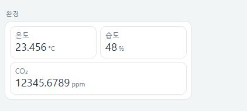

# UX 리뷰 반영 기록

리뷰 대상은 기존 카드 7종과 시각적 설정 편집기입니다. 목표는 작은 카드에서 상태를 읽고 자주 쓰는 조작을 바로 수행하는 것입니다. 아래 대표 화면은 실제 카드 코드를 모의 상태로 렌더링한 것으로 실제 HA 기기 연결 검증은 포함하지 않습니다.

## 냉난방: 아이콘 중심 구성 유지

모드 7개에 모두 글자를 붙이면 작은 카드에서 시각적 잡음이 늘어납니다. 현재 모드는 이름 아래 상태 텍스트와 선택 강조로 이미 표시되므로 기존 아이콘 구성을 유지했습니다. 각 버튼의 툴팁과 접근성 이름도 유지합니다. 냉난방은 이번 변경으로 버튼 수·행 수·카드 높이가 증가하지 않습니다.

## 같은 공간에서 의미를 더 명확하게

- **조명:** 색온도 레일에 따뜻한 빛→차가운 빛 단서를 넣었습니다. 방향키 100K, Shift+방향키 50K, Page Up/Down 500K, Home/End는 정확한 기기 한계값입니다. 포인터는 기존 1K 정밀도를 유지합니다.
- **커튼:** 조작 3개에만 작은 `열기·정지·닫기`를 넣었습니다. 기존 36px 데스크톱/44px 터치 버튼 영역 안에서 표시하고 카드 높이를 늘리지 않습니다.
- **홈 패널:** 비교 숫자 옆에 `이번 달 누적 / 지난달 전체`를 표시합니다. 반복 설명 행을 없애 더 작게 구성합니다. 두 기간의 차이를 같은 기간 대비 절감으로 해석하지 않아야 합니다.
- **환경:** 숫자는 중간에서 나누지 않고 단위를 더 작게 표시합니다. 지역화된 숫자 구분 문자를 보존하며 자동 배치는 실제 값의 너비에 맞춰 열 수를 조절합니다. 강제로 지정한 열 수는 유지하므로 긴 값에는 `columns: auto`를 권장합니다.

## 조작 흐름 유지

- **미디어:** 음소거 상태를 아이콘과 문구로 표시합니다. 지원 기기는 같은 음량 아이콘 위치에서 해제할 수 있습니다. 음량 조절만 전송 중일 때 재생/일시정지·다음 곡은 계속 사용할 수 있습니다. 음소거만 지원하는 기기는 기존 재생 조작 행에 버튼을 배치하여 빈 음량 행을 만들지 않습니다.
- **장면:** 여러 항목을 연속 실행해도 항목별 전달 성공·실패를 잠시 유지합니다. 성공은 요청 전달을 뜻하며 실제 장치 동작 완료를 의미하지 않습니다.
- **슬라이더:** 요청 중 포커스를 유지하고 중복 입력만 막습니다. Tab으로 다른 조작부로 이동할 수 있으며 요청이 끝나도 사용자가 이동한 포커스를 되돌리지 않습니다. 연결 불가 상태는 실제 비활성화를 적용합니다.

## 설정 과정의 불필요한 동작 줄이기

항목을 재정렬해도 펼친 중첩 설정과 키보드 포커스가 해당 항목을 따라갑니다. 조명·스위치·select에는 적용되지 않는 실행 버튼 설정을 숨기고 기존 YAML 값은 보존합니다. 임계값은 `31°C 이상 · 주의`처럼 읽히는 요약으로 표시합니다. 선택적인 이름·아이콘은 `표시 설정` 안에 두고 임계값 입력은 너비에 맞춰 나란히 배치합니다.

## 검증 범위

DOM 회귀 검사와 모의 상태 브라우저 검증을 함께 수행했습니다. 실제 Chromium에서 밝기·색온도·커튼 위치·음량의 포커스 유지, 입력 중복 방지, 다른 곳으로 이동한 포커스를 되돌리지 않는 동작을 확인했습니다. 320px 긴 환경 숫자와 커튼, 390px 기본 카드·설정 UI를 확인했습니다. 실제 Home Assistant의 네이티브 폼 표시·저장과 기기 반응 속도는 별도 검증이 필요합니다.
