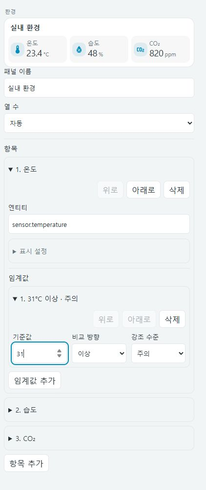

# 시각적 카드 편집기 / Visual card editor

7종 카드 모두 Home Assistant 카드 편집 화면에서 설정할 수 있습니다. YAML 편집도 계속 사용할 수 있으며 두 편집 방식은 같은 카드 설정을 사용합니다.

이미지는 로컬 모의 상태에서 기본 입력 폼으로 검증한 화면입니다. 실제 HA에서는 사용 가능한 네이티브 엔티티·아이콘·대상 선택기를 사용합니다.

## 시작하기

1. 대시보드 편집 → 카드 추가 → 원하는 **Compact** 카드를 선택합니다.
2. 엔티티 선택에서 실제 기기를 고릅니다. 이름과 아이콘을 바꾸려면 **표시 설정**을 펼칩니다. 이름을 비우면 엔티티 이름을 사용합니다.
3. 홈·장면·환경 패널은 **항목 추가**로 구성하고, 항목을 펼쳐 설정합니다. **위로 / 아래로 / 삭제**로 순서와 구성을 바꿉니다. 이동한 항목의 펼침 상태와 키보드 포커스는 유지됩니다.
4. 오른쪽 미리보기를 확인한 뒤 Home Assistant의 **저장**을 누릅니다.

편집기 자체는 기기 제어 서비스를 호출하지 않습니다. 설정 변경은 Home Assistant 미리보기에 전달되며 대시보드 저장은 Home Assistant가 처리합니다.

## 카드별 설정

| 카드 | 시각적으로 설정할 수 있는 항목 |
| --- | --- |
| `compact-climate-row` | 냉난방 엔티티, 표시 이름 |
| `compact-light-row` | 조명 엔티티, 표시 이름 |
| `compact-cover-row` | 커튼 엔티티, 표시 이름 |
| `compact-media-row` | 미디어 엔티티, 표시 이름, 음량·다음 곡 표시 |
| `compact-home-panel` | 자동/1/2열, 일반 엔티티·센서 이름 검색·제목·메모·냉난방·조명·커튼·미디어·사용량 비교·페이지 이동, 항목 순서 |
| `compact-scene-panel` | 패널 이름, 자동/1~4열, 장면·스크립트 엔티티, 이름·아이콘, 실행 전 확인 메시지, 항목 순서 |
| `compact-environment-panel` | 패널 이름, 자동/1~4열, 센서 엔티티, 이름·아이콘, 숫자 임계값·이상/이하·주의/위험, 항목 순서 |

조명 밝기·색온도, 커튼 위치, 냉난방 모드는 기기 기능에 맞춰 카드가 자동으로 표시합니다. 편집기에서 별도로 활성화할 필요가 없습니다.

## 홈 패널의 복합 항목

- **제목**: 제목과 센서 배지를 설정합니다. 배지도 추가·삭제·재정렬할 수 있습니다.
- **메모**: 여러 줄 텍스트를 입력합니다.
- **사용량 비교**: 각 행의 이름, 이번 달 누적 센서, 지난달 전체 센서를 선택합니다. 비교 행을 추가·삭제·재정렬할 수 있습니다.
- **페이지 이동**: `/energy`처럼 Home Assistant 내부 경로를 입력하고 아이콘을 선택합니다.
- **이름 터치 동작**: 일반 엔티티 항목에서 기본 상세 정보, 명시적 상세 정보(`more-info`), 켜기/끄기 전환(`toggle`)을 선택합니다. `toggle`은 항목에 명시한 `entity` 자체를 전환합니다. 오른쪽 전용 토글·옵션 선택은 유지되며, `find_name`만 사용하는 상태 표시 항목에는 토글을 적용할 수 없습니다. [홈 패널 가이드](compact-home-panel.md#이름-터치-동작)에 동작과 확인 메시지 예제가 있습니다.
- **서비스 실행 버튼**: 전용 제어가 없는 일반 항목에서는 `perform-action`을 선택하고 `button.press`, `script.turn_on` 같은 액션 이름과 대상을 지정합니다. 대상 생략 시 항목 엔티티를 사용합니다. 실행 전 확인 메시지도 설정할 수 있습니다. `light`, `switch`, `select`는 오른쪽 전용 제어가 우선합니다. 기존 YAML의 `tap_action`과 그 안의 추가 필드는 보존됩니다.
- **액션 데이터**: 키별로 문자열·숫자·참/거짓 값을 추가·편집·삭제합니다. 이미 YAML로 작성한 배열이나 중첩 객체는 보존되며, 구조화된 데이터의 세부 편집은 YAML에서 합니다.

## 작은 화면에서 빠르게 설정하기

선택적인 이름·아이콘은 **표시 설정** 안에 두어 기본 엔티티 선택을 먼저 보여줍니다. 임계값은 `31°C 이상 · 주의`처럼 센서 단위·방향·강조 수준을 한 줄로 요약하며, 기준값·방향·수준 입력은 너비에 따라 나란히 표시하거나 감쌉니다. 센서가 단위를 제공하지 않으면 숫자와 방향만 표시합니다. 비교 항목의 센서 선택은 **이번 달 누적 센서 / 지난달 전체 센서**로 구분합니다.

## 기존 YAML과 호환

편집기는 변경한 필드만 반영하며 기존의 알 수 없는 키, 카드 레이아웃 옵션과 중첩 액션 데이터를 유지합니다. 화면을 열거나 엔티티 상태가 갱신되는 것만으로 설정 변경을 보내지 않습니다. 선택적 필드를 비우면 해당 설정을 제거해 카드 기본값을 사용합니다. 항목 삭제나 실행 버튼 해제는 해당 항목 또는 액션을 삭제합니다.

Home Assistant 기본 폼을 사용하여 엔티티·아이콘·대상 선택기를 제공합니다. 폼이 아직 로드되지 않았으면 Home Assistant의 카드 헬퍼로 기본 편집기를 먼저 불러옵니다. 헬퍼가 없는 환경에서는 기본 입력 필드와 엔티티 제안 목록으로 동작하며, 대상 입력은 엔티티 ID를 쉼표로 구분합니다. 폼 없이 대상 엔티티를 바꾸더라도 기존 장치·영역 대상은 유지됩니다.

이름 터치 동작은 `toggle`, `more-info`, `perform-action` 범위에서 제공합니다. 길게 누르기·두 번 누르기나 Home Assistant의 전체 액션 스키마를 지원한다는 뜻은 아닙니다.

## English

All seven cards expose Home Assistant visual configuration editors. Pick a Compact card, choose an entity, edit its optional name, and save with Home Assistant. Panels provide expandable items with add, remove and reorder controls; reordering keeps the moved item expanded and restores keyboard focus. Optional names/icons live in expandable display settings. Threshold summaries include the sensor unit, direction and localized severity, and their inputs adapt to available width. Home panels include headings/badges, notes, entity lookup, embedded controls, navigation, comparison rows and action buttons. Scene panels expose confirmations. Environment panels expose numeric thresholds, comparison directions and warning levels.

Native HA entity, icon and target selectors are used when available; native inputs provide a fallback without frontend helpers. Media visibility fields reflect their default `true` values. Unknown YAML fields and nested action data survive edits, and incoming configurations are never mutated. Primitive action data has typed fields; existing arrays and nested objects are preserved and remain editable in YAML. The editor emits `config-changed` without calling device services. Dashboard persistence belongs to Home Assistant.

Home-panel plain entity items provide a name-tap action selector for default details, `more-info`, `toggle`, and (without dedicated right-hand controls) `perform-action`. Toggle requires an explicit item entity; dedicated right-hand controls keep their behavior. Support is limited to these tap actions, not hold/double-tap or the complete HA action schema.

Implementation follows the official [custom card editor API](https://contributors.home-assistant.io/frontend/custom-ui/card-editor/) and the native [ha-form component](https://github.com/home-assistant/frontend/blob/dev/src/components/ha-form/ha-form.ts). DOM tests cover config events, immutable round trips, nested lists, add/remove/reorder, selector bootstrap and fallback fields; live HA integration and real browser rendering require separate verification.
